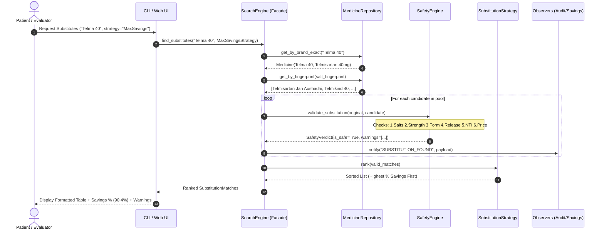
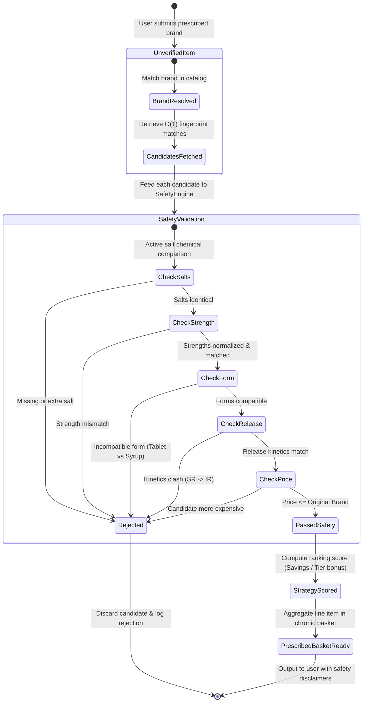

# Software Architecture & UML Design Document
## EquiMed-India: Generic Drug Substitution & Affordability Optimizer

**Institution:** Indian Institute of Information Technology (IIIT), Lucknow  
**Course:** Software Engineering (Credits: 4)  
**Standard:** UML 2.5 & DFD Level 0/1 Specifications  

---

## 1. System Architecture Overview

EquiMed-India employs a **Layered Architecture** adhering to the **Separation of Concerns (SoC)** and **Single Responsibility Principle (SRP)**:

```
+-------------------------------------------------------------------------+
|                        1. PRESENTATION LAYER                            |
|     +----------------------------------+  +-----------------------+     |
|     |  Interactive Terminal CLI        |  |  Zero-Dependency Web  |     |
|     |  (ANSI formatted tables/boxes)   |  |  Embedded REST Server |     |
|     +-----------------+----------------+  +-----------+-----------+     |
+-----------------------|-------------------------------|-----------------+
                        |                               |
+-----------------------v-------------------------------v-----------------+
|                        2. BUSINESS LOGIC LAYER                          |
|     +-------------------------------------------------------------+     |
|     |  SearchEngine (Facade & Observable Subject)                 |     |
|     +------------------------------+------------------------------+     |
|                                    |                                    |
|        +---------------------------+---------------------------+        |
|        |                           |                           |        |
|        v                           v                           v        |
|  +-------------------+   +--------------------+   +------------------+  |
|  | SafetyEngine      |   | Strategy Engine    |   | Prescription     |  |
|  | (Bioequivalence   |   | (GoF Strategy      |   | Optimizer        |  |
|  |  & NTI Guard)     |   |  MaxSavings,       |   | (Chronic Therapy |  |
|  |                   |   |  PMBJP, Balanced)  |   |  Baskets)        |  |
|  +-------------------+   +--------------------+   +------------------+  |
+------------------------------------+------------------------------------+
                                     |
+------------------------------------v------------------------------------+
|                   3. PERSISTENCE & DATA LAYER                           |
|     +-------------------------------------------------------------+     |
|     |  MedicineRepository (Inverted Multi-Index)                  |     |
|     |  - O(1) ID Map                                              |     |
|     |  - O(1) Exact Brand Map                                     |     |
|     |  - O(1) Chemical Salt Fingerprint Hash Index                |     |
|     |  - Inverted Constituent Active Salt Index                   |     |
|     +------------------------------+------------------------------+     |
|                                    |                                    |
|  +---------------------------------v---------------------------------+  |
|  |  Observer Telemetry Subsystem                                     |  |
|  |  (AuditLogObserver, SavingsTrackerObserver, SafetyAlertObserver)  |  |
|  +-------------------------------------------------------------------+  |
+-------------------------------------------------------------------------+
```

---

## 2. Data Flow Diagrams (DFD)

### 2.1 DFD Level 0: Context Diagram
The Level 0 Context Diagram establishes the boundary between external entities (Patient, Pharmacist, Evaluator) and the EquiMed engine.

```
       +-----------------------+
       |   Patient / Doctor    |
       |     / Pharmacist      |
       +-----------+-----------+
                   |
     1. Brand Name / Prescription
                   |
                   v
       +-----------------------+
       |                       |
       |      0. EquiMed       |
       |    Generic Drug       |
       |      Optimizer        |
       |                       |
       +-----------+-----------+
                   |
     2. Bioequivalent Generic Matches
        + Percentage Savings (₹)
        + Clinical Safety Disclaimers
                   |
                   v
       +-----------------------+
       |   Patient / Doctor    |
       |     / Pharmacist      |
       +-----------------------+
```

### 2.2 DFD Level 1: Functional Decomposition

```
[ User Input: Brand Name ]
           |
           v
+------------------------+
| 1.0 Brand Lookup       | ----> [ Medicine Catalog ]
+-----------+------------+
            |
      Resolved Medicine
            |
            v
+------------------------+
| 2.0 Inverted Hash      | <---> [ Salt Fingerprint Index ]
|     Candidate Retrieval|
+-----------+------------+
            |
      Raw Candidates
            |
            v
+------------------------+
| 3.0 Clinical           | ----> [ Safety Verdict & NTI Rules ]
|     Bioequivalence     |
|     Validation         | ----> (If Rejected: Log Veto Reason)
+-----------+------------+
            |
      Safe Verified Candidates
            |
            v
+------------------------+
| 4.0 Strategy Scoring   | <---> [ Strategy Configuration ]
|     & Economic Ranking |       (MaxSavings / PMBJP / Balanced)
+-----------+------------+
            |
      Ranked Generic Matches
            |
            +---------------------> [ 5.0 Observer Telemetry & Audit ]
            |
            v
[ Output: Verified Generic Report with Savings % ]
```

---

## 3. UML Class Diagram

```mermaid
classDiagram
    class DosageForm {
        <<enumeration>>
        TABLET
        CAPSULE
        SYRUP
        INJECTION
        INHALER
    }

    class ReleaseType {
        <<enumeration>>
        IMMEDIATE_RELEASE
        SUSTAINED_RELEASE
        EXTENDED_RELEASE
        CONTROLLED_RELEASE
        ENTERIC_COATED
    }

    class RegulatoryTier {
        <<enumeration>>
        PMBJP_JAN_AUSHADHI
        WHO_GMP_GENERIC
        CDSCO_APPROVED_GENERIC
        BRANDED_INNOVATOR
        BRANDED_GENERIC
    }

    class SaltComponent {
        +String name
        +float strength_value
        +String strength_unit
        +normalized_key() String
    }

    class Medicine {
        +String id
        +String brand_name
        +String manufacturer
        +List~SaltComponent~ salts
        +DosageForm dosage_form
        +ReleaseType release_type
        +float mrp
        +float price_per_unit
        +RegulatoryTier regulatory_tier
        +bool is_narrow_therapeutic_index
        +salt_fingerprint() String
    }

    class SafetyVerdict {
        +bool is_safe
        +bool is_exact_bioequivalent
        +String rejection_reason
        +List~String~ warnings
    }

    class SubstitutionMatch {
        +Medicine original_medicine
        +Medicine substitute_medicine
        +float savings_per_unit
        +float percentage_savings
        +SafetyVerdict safety_verdict
        +float ranking_score
    }

    class SafetyEngine {
        +normalize_salt_name(name) String
        +normalize_strength(val, unit) Tuple
        +validate_substitution(orig, candidate) SafetyVerdict
    }

    class SubstitutionStrategy {
        <<interface>>
        +name: String
        +rank(matches) List~SubstitutionMatch~
    }

    class MaxSavingsStrategy {
        +rank(matches) List~SubstitutionMatch~
    }

    class JanAushadhiFirstStrategy {
        +rank(matches) List~SubstitutionMatch~
    }

    class ReputationBalancedStrategy {
        +rank(matches) List~SubstitutionMatch~
    }

    class SubstitutionObserver {
        <<interface>>
        +on_event(event_type, payload) void
    }

    class AuditLogObserver {
        +logs: List
        +on_event(event_type, payload) void
    }

    class SavingsTrackerObserver {
        +cumulative_potential_savings: float
        +on_event(event_type, payload) void
    }

    class SafetyAlertObserver {
        +nti_alerts_count: int
        +rejection_count: int
        +on_event(event_type, payload) void
    }

    class SearchEngine {
        -MedicineRepository repository
        -SafetyEngine safety_engine
        -SubstitutionStrategy default_strategy
        +find_substitutes(query, strategy) List~SubstitutionMatch~
    }

    class PrescriptionOptimizer {
        -SearchEngine search_engine
        +optimize_basket(basket_id, profile, items) BasketOptimizationResult
    }

    Medicine *-- SaltComponent
    Medicine --> DosageForm
    Medicine --> ReleaseType
    Medicine --> RegulatoryTier
    SubstitutionMatch --> Medicine
    SubstitutionMatch --> SafetyVerdict

    SubstitutionStrategy <|.. MaxSavingsStrategy
    SubstitutionStrategy <|.. JanAushadhiFirstStrategy
    SubstitutionStrategy <|.. ReputationBalancedStrategy

    SubstitutionObserver <|.. AuditLogObserver
    SubstitutionObserver <|.. SavingsTrackerObserver
    SubstitutionObserver <|.. SafetyAlertObserver

    SearchEngine --> SafetyEngine
    SearchEngine --> SubstitutionStrategy
    SearchEngine o-- SubstitutionObserver
    PrescriptionOptimizer --> SearchEngine
```



---

## 4. UML Sequence Diagram: Generic Substitution & Safety Flow



---

## 5. UML State Machine Diagram: Prescription Item Lifecycle



---

## 6. Scrum / Agile Sprint Execution Documentation

### 6.1 Scrum Team Organization
- **Project Goal:** Build, verify, and document a deterministic generic drug substitution optimizer.
- **Sprint Duration:** 1 Day Intensive (Micro-sprints, 3 iterations of 2.5 hours each).

### 6.2 User Stories & Acceptance Criteria

| User Story ID | Title & Description | Acceptance Criteria |
| :--- | :--- | :--- |
| **US-01** | **Brand Lookup & Fingerprint Matching**<br>As a user, I want to type any Indian brand name and find medicines with identical salt compositions. | Exact brand matches in $< 1\text{ ms}$; combination drugs match regardless of component order. |
| **US-02** | **Clinical Bioequivalence Guard**<br>As a pharmacist, I want the system to reject any generic that has different release kinetics or missing salts. | 0 false substitutions; Sustained Release $\rightarrow$ Immediate Release clashing strictly blocked. |
| **US-03** | **Narrow Therapeutic Index Alert**<br>As a patient taking thyroid or anticoagulant medicines, I want clear clinical alerts prior to brand switching. | Thyroxine and Warfarin automatically trigger mandatory physician consultation alerts. |
| **US-04** | **Customizable Savings Ranking**<br>As a budget-conscious patient, I want to prioritize Jan Aushadhi government stores or highest percentage savings. | Strategy Pattern allows instant toggling between MaxSavings, JanAushadhiFirst, and Balanced. |
| **US-05** | **Chronic Multi-Morbidity Basket**<br>As an elderly patient with multiple diseases, I want to see my total monthly and annual projected savings. | Aggregates multi-drug prescriptions and generates 30-day and 365-day savings breakdowns. |

### 6.3 Sprint Burndown & Velocity
- Total Story Points Planned: 21 Points
- Sprint 1 (Core Domain & Inverted Index): 8 Points completed (100%)
- Sprint 2 (Safety Engine & Strategy Pattern): 8 Points completed (100%)
- Sprint 3 (CLI, Web UI, Test Automation, & Benchmarks): 5 Points completed (100%)
- Final Velocity: 21 / 21 Story Points (100% On-Time Delivery).
